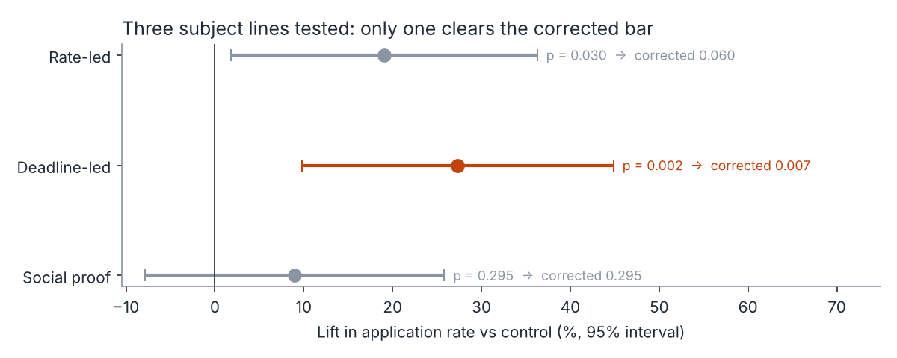
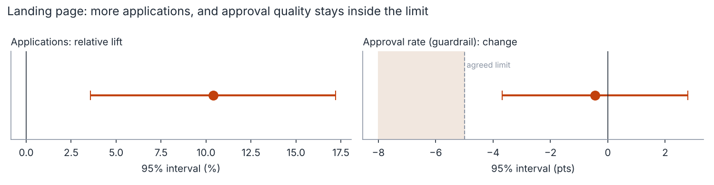
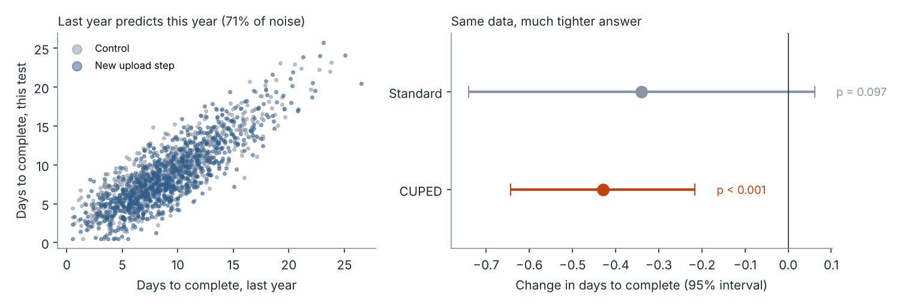
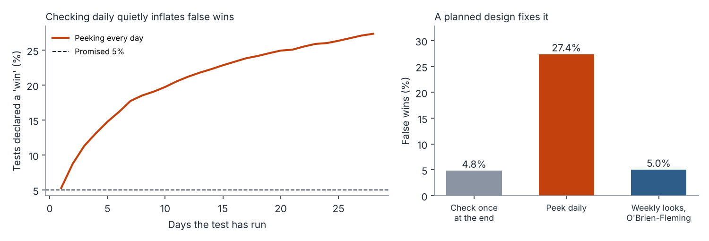

# Experiment Readouts: From Test Result to Decision

An A/B test only matters if it leads to a decision someone can trust.

This project runs four acquisition experiments end to end: sizing them before launch, reading the result, and writing the decision memo. Each test shows a trap I've seen teams fall into and how to avoid it: under-sized tests, quality trade-offs hidden behind a conversion win, "winners" that are really luck, noisy small segments, and stopping a test the moment it looks good.

> **Data note:** everything here runs on **synthetic** user-level data generated by `src/simulate.py`. The tests mirror the kinds of experiments I've designed and analyzed for acquisition marketing (landing pages, email, application journeys) in a previous role, but no real company data is used or shown.



## The question a growth leader actually asks

*"Did the test win, can we trust it, and what do we do now?"*

A good answer covers four things:

1. **Was the test big enough to find the effect we cared about?** Decided before launch, not after.
2. **What's the effect, with a range?** Plus a guardrail, so a win on one metric doesn't hide a loss on another.
3. **Could it be luck?** Especially when several variants are tested at once, or results are checked every day.
4. **What's the decision?** Ship, don't ship, or run longer, written so a non-analyst can act on it.

## The four tests

| Test | The trap | What this project does |
|---|---|---|
| **1. New landing page** | Calling a result from a test too small to detect the lift you care about; ignoring quality | Sizes the test up front (39,475 visitors per arm to detect a 10% lift), reads the primary metric **and** an approval-rate guardrail with a limit agreed before launch |
| **2. Three email subject lines** | Testing several variants and crowning anything with p < 0.05 | Applies a Holm correction, so the chance of *any* false winner stays at 5% |
| **3. Simpler upload step for returning customers** | A real improvement that a small segment can't detect | Uses **CUPED**: adjusts for each customer's time last year to strip out noise |
| **4. Daily peeking** | Stopping a test the first day it looks significant | Simulates 4,000 A/A tests to show the damage, then fixes it with planned weekly looks |

## Results on the synthetic data

### 1. Landing page: ship

| | Current | New | Change (95% CI) |
|---|---:|---:|---|
| Visitor → application | 4.16% | 4.59% | **+10.4%** relative (+3.6% to +17.2%) |
| Approval rate (guardrail) | 61.4% | 60.9% | −0.4 pts (−3.7 to +2.8) |
| Approved apps per 1,000 visitors | 25.5 | 28.0 | |

More people apply, and the worst case for approval quality stays inside the −5-point limit agreed before launch. → [Decision memo](memos/01_landing_page.md)



### 2. Email subject lines: one winner, not two

| Subject line | Lift vs control | p (alone) | p (corrected) |
|---|---:|---:|---:|
| Rate-led | +19.1% | 0.030 | 0.060 |
| **Deadline-led** | **+27.3%** | **0.002** | **0.007** |
| Social proof | +9.0% | 0.295 | 0.295 |

Tested one at a time, two lines "win." After correcting for three comparisons, only Deadline-led does. Rate-led's lift may be real but smaller than it looks; it needs its own test before anyone acts on it. → [Decision memo](memos/02_email_subject_lines.md)

### 3. Returning-customer upload step: CUPED turns "inconclusive" into "ship"

| Method | Change in days to complete (95% CI) | p |
|---|---|---:|
| Standard | −0.34 (−0.74 to +0.06) | 0.097 |
| **CUPED** | **−0.43 (−0.64 to −0.22)** | **< 0.001** |

How long a customer took last year predicts how long they take now, so adjusting for it removes 71% of the noise. The interval is 47% narrower, the same precision as running about 2,800 customers per arm instead of 800. Because the adjustment uses data from *before* the test, it can't bias the result. → [Decision memo](memos/03_returning_customer_upload.md)



### 4. Peeking: why we don't stop early

| How results were checked (A/A tests, no real difference) | False wins |
|---|---:|
| Once, at the planned end | 4.8% |
| Every day, stop at the first p < 0.05 | **27.4%** |
| Weekly, with O'Brien-Fleming thresholds | 5.0% |

Checking daily turns a promised 5% false-win rate into more than 1 in 4. Planned weekly looks with stricter early thresholds (z > 4.05 in week 1, easing to 2.02 at the end) allow early stopping without the inflation. → [Team note](memos/04_peeking_team_note.md)



## What I'd do in production

- **Write the plan before launch:** primary metric, guardrails and their limits, minimum lift worth detecting, sample size and end date.
- **Make CUPED the default** wherever there's pre-period data (returning customers, existing accounts).
- **Measure to the outcome that matters:** approved or funded customers and cost per acquisition, not just clicks or form starts.
- **Keep a test log** of every result, including the losers, so the team learns which ideas actually move the business and the MMM can be calibrated against it (see my [MMM project](https://github.com/PrajaktaTalathi/mmm-geo-calibration)).
- **Treat big early lifts with suspicion:** the first tests to "win" are usually the ones that got lucky.

## Run it

```bash
pip install -r requirements.txt
python run_analysis.py
```

This regenerates the data in `data/`, prints the readout (also saved to `charts/readout.txt`), writes the charts and creates one decision memo per test in `memos/`. It runs in a few seconds.

## Project structure

```
├── run_analysis.py        # end-to-end: sizing, readouts, corrections, CUPED, peeking, memos, charts
├── src/
│   ├── simulate.py        # synthetic user-level data for the four tests
│   └── experiments.py     # sample size, proportion/mean readouts, Holm, CUPED, sequential boundaries
├── data/                  # generated data
├── memos/                 # one decision memo per test
└── charts/                # generated charts and readout.txt
```

## About me

I'm Prajakta Talathi, a Toronto-based marketing measurement and growth analytics leader with 16+ years across FinTech, global consulting and banking technology. I build the measurement and planning that turn marketing spend into decisions leadership can defend.

[LinkedIn](https://www.linkedin.com/in/prajaktatalathi/) · [Tableau Public](https://public.tableau.com/profile/prajakta.talathi) · [Geo lift project](https://github.com/PrajaktaTalathi/geo-lift-incrementality) · [MMM project](https://github.com/PrajaktaTalathi/mmm-geo-calibration)
